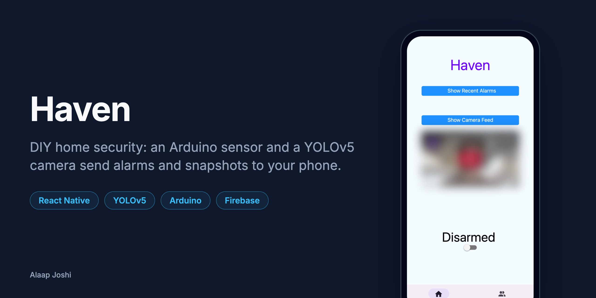
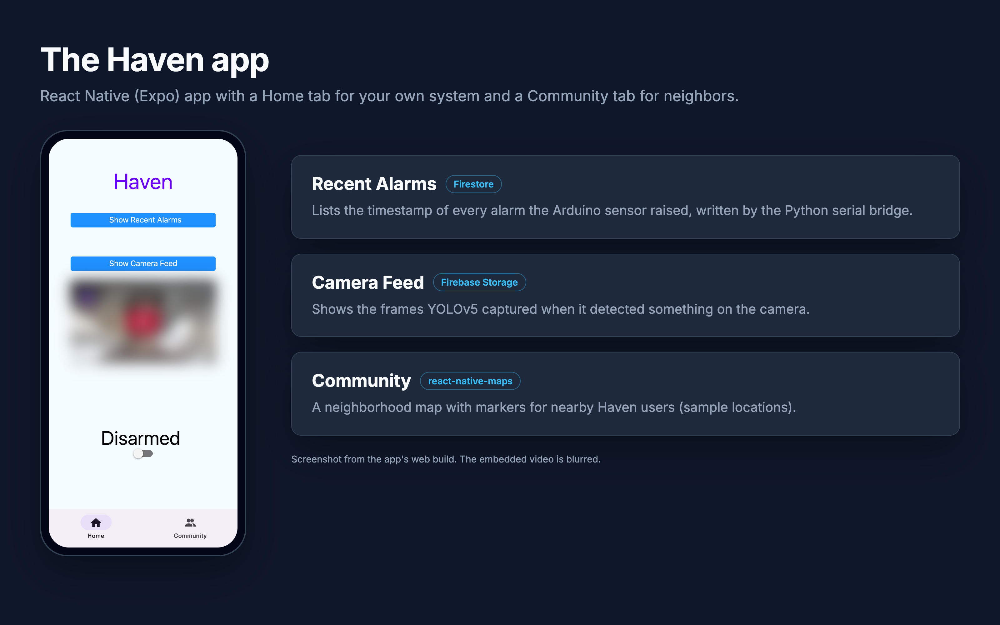
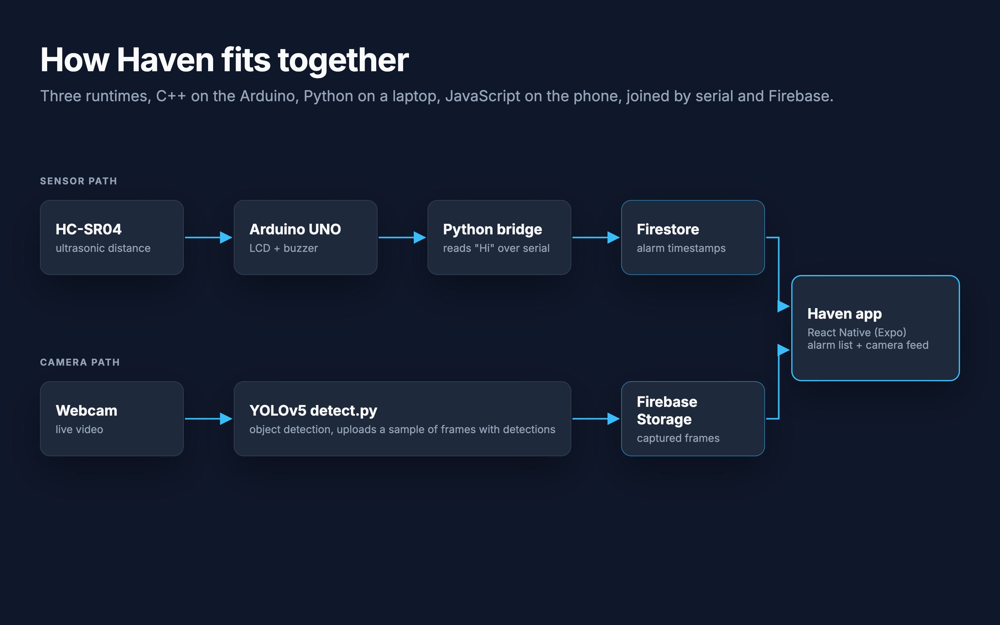
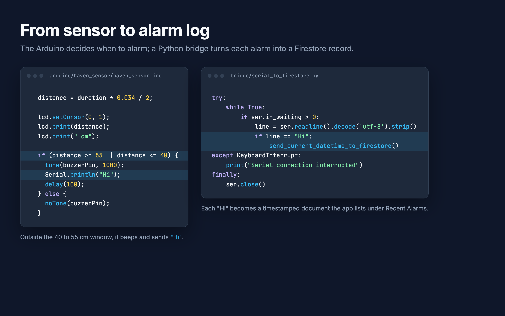
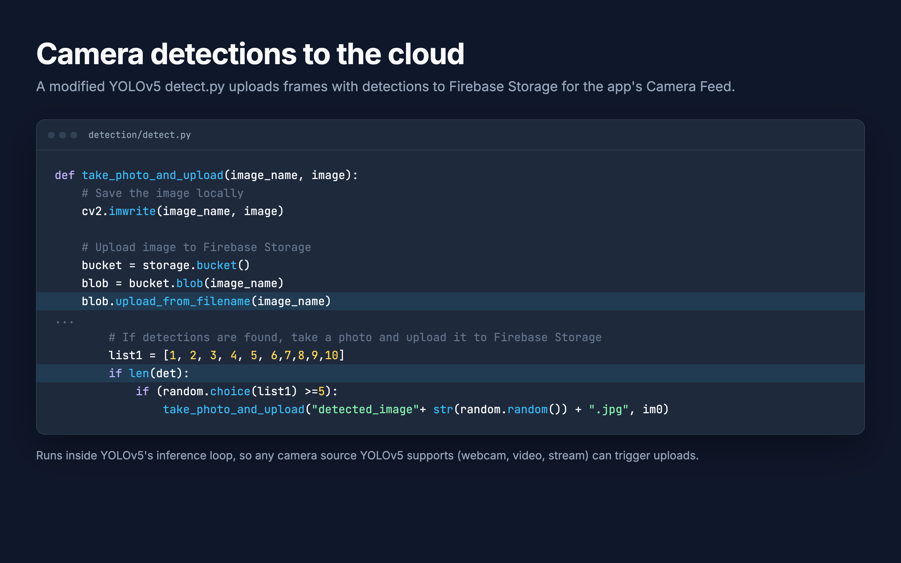

# Haven

> A DIY home security system: an Arduino distance sensor and a YOLOv5 camera log alarms and snapshots to Firebase, and a React Native app shows them on your phone.

   

## About
Off-the-shelf security cameras are expensive and tied to one vendor's cloud. Haven builds the same core loop from cheap parts: an ultrasonic sensor on an Arduino trips an alarm, a laptop webcam running YOLOv5 captures frames with detected objects, and both feed a Firebase backend that a phone app reads. The interesting part is the glue: three runtimes (C++ on the microcontroller, Python on the host, JavaScript on the phone) talking through a serial link and Firebase.

**1st Place Overall at MontyHacks VII.**

## Features
- Detects movement with an HC-SR04 ultrasonic sensor, shows the live distance on a 16x2 LCD, and sounds a buzzer.
- Logs every alarm to Firestore with a timestamp, through a Python serial bridge.
- Runs YOLOv5 object detection on a camera feed and uploads frames with detections to Firebase Storage.
- Lists recent alarms and captured camera frames in a React Native (Expo) app.
- Shows a neighborhood map with nearby Haven users on a Community tab (sample markers).

## Gallery
<table>
  <tr>
    <td width="50%"> The app's Home tab: recent alarms, camera feed, and the arm switch</td>
    <td width="50%"> How the sensor, camera, Firebase, and app connect</td>
  </tr>
  <tr>
    <td width="50%"> The Arduino trips the alarm when the measured distance leaves 40 to 55 cm</td>
    <td width="50%"> YOLOv5 frames with detections are uploaded to Firebase Storage</td>
  </tr>
</table>

## Tech Stack
| Layer | Technology |
|---|---|
| Mobile app | React Native, Expo SDK 51, React Navigation, react-native-maps |
| Backend | Firebase Firestore (alarms), Firebase Storage (camera frames) |
| Computer vision | YOLOv5 (PyTorch), OpenCV, firebase-admin |
| Hardware | Arduino UNO, HC-SR04 ultrasonic sensor, 1602 I2C LCD, buzzer |
| Serial bridge | Python, pyserial, firebase-admin |

## Getting Started

### Prerequisites
- Node 18+ and the Expo Go app (or an Expo development build) on your phone
- Python 3.9+
- Arduino IDE 2 with the `LiquidCrystal_I2C` library
- A Firebase project with Firestore and Storage enabled, plus a service-account key (JSON) saved **outside** this repo

### Installation
~~~bash
git clone https://github.com/alaapjoshi/Haven.git
cd Haven

# Mobile app
cd app
npm install
cp .env.example .env.local   # fill in your Firebase web config
cd ..

# Python: serial bridge and detection
python3 -m venv .venv && source .venv/bin/activate
pip install -r bridge/requirements.txt
git clone https://github.com/ultralytics/yolov5 detection/yolov5
pip install -r detection/yolov5/requirements.txt -r detection/requirements.txt
cp detection/detect.py detection/yolov5/detect.py

# Both Python scripts read the key path from this variable
export FIREBASE_CREDENTIALS=/path/to/your-service-account.json
~~~

### Usage
1. **Sensor.** Open `arduino/haven_sensor/haven_sensor.ino` in the Arduino IDE and upload it to the UNO (HC-SR04 trig on pin 9, echo on pin 10, buzzer on pin 8, LCD on I2C address `0x27`).
2. **Serial bridge.** Set the serial port in `bridge/serial_to_firestore.py` to your Arduino's port, then run:
   ~~~bash
   python bridge/serial_to_firestore.py
   ~~~
   Each alarm prints a line like `Sent current datetime: 2024-05-18 14:02:11 to Firestore`.
3. **Camera detection.** Run YOLOv5 on your webcam:
   ~~~bash
   cd detection/yolov5
   python detect.py --source 0
   ~~~
   Uploaded frames print `File uploaded to: <url>`.
4. **App.** Start Expo and scan the QR code with Expo Go:
   ~~~bash
   cd app
   npx expo start
   ~~~
   On the Home tab, tap **Show Recent Alarms** or **Show Camera Feed**.

## Project Structure
~~~text
Haven/
  app/                         # React Native (Expo) mobile app
    App.js                     # tab navigation and Home screen
    AlarmList.js               # reads alarm timestamps from Firestore
    CameraFeed.js              # lists camera frames from Firebase Storage
    CommunityMap.js            # neighborhood map (Community tab)
    firebaseConfig.js          # Firebase client, configured from .env.local
  arduino/haven_sensor/        # Arduino sketch: distance sensor, LCD, buzzer
  bridge/                      # Python: Arduino serial -> Firestore
  detection/                   # modified YOLOv5 detect.py: detections -> Storage
  docs/images/                 # README images (src/ holds the HTML sources)
~~~

## How It Works
The Arduino reads the HC-SR04 once a second and prints the distance to the LCD. When the reading falls outside a 40 to 55 cm window, it sounds the buzzer and writes `Hi` over serial. The Python bridge listens on that serial port and writes a timestamped document to Firestore for each `Hi`.

Separately, a modified YOLOv5 `detect.py` runs on a webcam feed. When a frame has detections, it saves a sample of those frames and uploads them to Firebase Storage. The app reads both: Firestore for the alarm list and Storage for the camera feed.

~~~mermaid
flowchart LR
  S[HC-SR04 sensor] --> A[Arduino UNO LCD + buzzer]
  A -- "serial: Hi" --> B[Python bridge]
  B -- alarm timestamp --> F[(Firestore)]
  C[Webcam] --> Y[YOLOv5 detect.py]
  Y -- detection frames --> St[(Firebase Storage)]
  F --> M[React Native app]
  St --> M
~~~

## Future Improvements
- Wire the Armed/Disarmed switch to the backend so it actually gates alarms (it is UI-only today).
- Send push notifications with Firebase Cloud Messaging instead of requiring the user to open the alarm list.
- Replace the placeholder YouTube embed on the Home tab with the live camera stream.
- Move the serial port and Firestore collection name into config, and add Firebase Auth with security rules.

## Author
**Alaap Joshi** - Computer Science + Cognitive Science, Rutgers University-New Brunswick
[GitHub](https://github.com/alaapjoshi) | [LinkedIn](https://linkedin.com/in/alaapjoshi)

## License
MIT. See [LICENSE](LICENSE). `detection/detect.py` is a modified copy of Ultralytics YOLOv5 and stays under AGPL-3.0.
